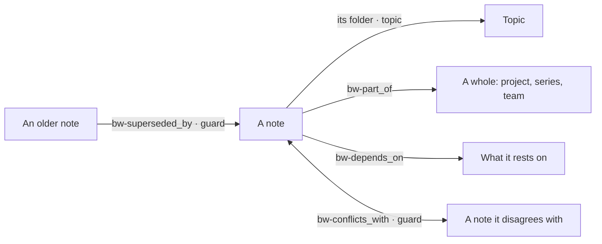

# Typed relations

Status: concluded; next, a proposal.
Question: which relation types should brain-wiki read again, and how should they be written?

The most used relation has no field: a note's folder says which topic it
is part of. Format 2 also gave notes five relation families. Format 3
replaced them with plain links
([D33](../../decision/d33-no-meaning-extraction.md)) and kept only
supersession, as metadata. This study takes each relation on its own
merits: what it would let the engine do that folders, links, and metadata
fields cannot, and whether it can be written without repeating format 2's
mistakes.

## At a glance

- **The storage failed, not the idea.** Format 2 kept relations as YAML strings in frontmatter, and only consolidation wrote most of them. Nothing in the record says the families or the guards were wrong ([background](background.md)).
- **A relation earns its place through behavior.** Each one is judged by the same [criteria](criteria.md), starting with what the engine would do with it.
- **Relations are metadata.** A relation is a quoted link in a `bw-<verb>` frontmatter field, one field per relation in one direction; a `## Relations` section in the body is free prose ([syntax](syntax.md)).

## Concepts

| Concept | Format 2 family | Today | Status | Verdict |
|---|---|---|---|---|
| [topic](topic.md) | Containment, by folder | Folders and topic pages | Concluded | Keep as the primary part_of; every folder is a topic, and its title lives on its page |
| [part_of](part-of.md) | Containment | Folder membership only | Concluded | Revive as `bw-part_of` on each part, covering membership |
| [depends_on](depends-on.md) | Dependency | A "Depends on" bullet nothing reads | Concluded | Revive as `bw-depends_on` on the dependent note, for requirements only |
| [conflicts_with](conflicts-with.md) | Conflict, a guard | A sentence with a link | Concluded | Revive as `bw-conflicts_with`, written once on either note, with a guard between active notes |
| [supersedes](supersedes.md) | Lineage, a guard | `bw-superseded_by` metadata | Concluded | Keep, with the same field shape as the other relations |
| [related_to](related-to.md) | Peer | A plain link | Concluded | Drop; a plain link already says it |

The resulting set: one relation by folder and four fields.

## Shared material

| File | What it holds |
|---|---|
| [background.md](background.md) | The three formats, the format 2 relation model, what used it, why format 3 removed it, and what survives |
| [criteria.md](criteria.md) | The eight tests every relation is judged by |
| [syntax.md](syntax.md) | How relations are written: one link field per relation, a free-form `## Relations` section; the options it was chosen over |

## Shared findings

Findings that hold for every relation, added as analyses conclude.

- **Where relations live** (set by the maintainer, 2026-10-17): each
  relation is a quoted wikilink in a `bw-<verb>` frontmatter field, and
  nothing else goes in the field. A `## Relations` section in the body is
  free-form prose for people: it may explain the fields or not, as the user
  likes, and brain-wiki never parses or checks it.
- **One canonical direction.** Each relation has one field, on one side;
  its analysis names the side.
- **One name per relation.** No alias fields; an unknown `bw-` field is an
  error ([fewer concepts](../README.md#principle-fewer-concepts)).
- Any revival amends D33 to read: relation types are metadata the author
  declares, and brain-wiki never infers one from prose.
- It also needs a new format version, because format 3 lint treats both a
  `## Relations` section with bullets (format 1) and `bw-<verb>` fields
  (format 2) as legacy to convert away.
- A relation must be writable by direct edit
  ([D34](../../decision/d34-direct-edits.md)) and checkable by
  `brain validate`.
- From part_of: one relation can cover close meanings (part_of covers
  membership) as long as the engine follows its chains one level by
  default.
- **One shape for every field** (from supersedes): a relation
  field holds one or more quoted links, written as one value or a list.
- **No search intents** (from depends_on): relations show in the
  read outline ("Part of", "Depends on", "Depended on by", "Conflicts
  with") and in `brain_neighbors` filtered by relation.
- **One stale report:** `reports/stale.md` lists notes resting
  on outdated notes, open conflicts, and plain stale links, in that order.
- **The relations meet at lifecycle.** A conflict is resolved by
  superseding one side, which ends its guard; a superseded or archived
  note flags the notes that depend on it.
- `bw-sources` stays as provenance and is outside this study.
- **Order is not a concept.** A relation field is a set of links. Where
  order matters, the titles carry it, as a convention of the folder whose
  notes follow a shared template; lists of notes sort by title, comparing
  numbers as numbers.

## Path to a proposal

1. Analyze each concept and record its verdict in the table above. Done:
   all six concluded on 2026-10-18.
2. In each relation's analysis, name its one canonical direction. Done.
3. Write one proposal for the relations that pass, with the new format,
   its converter, and bench cases, and amend D33 by a new decision.
