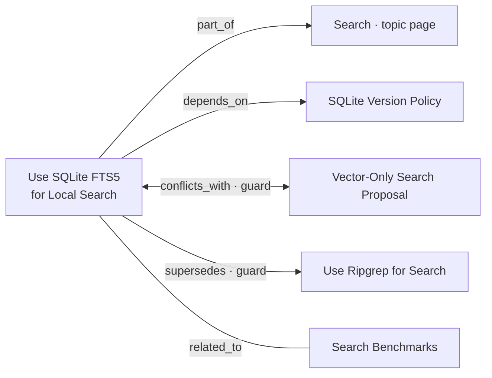
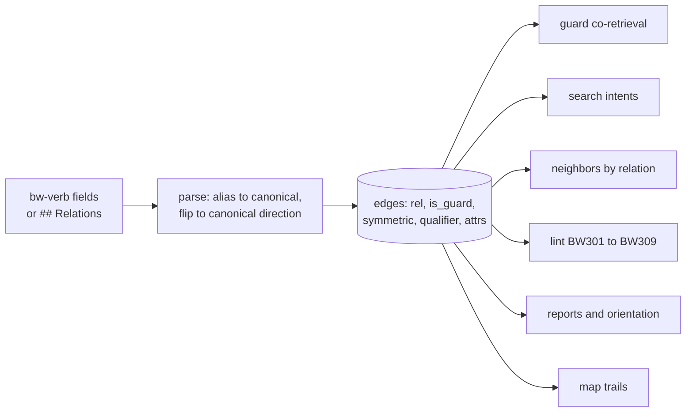

# Background: relations in formats 1 to 3

Status: draft.
Study: [Typed relations](README.md).

What brain-wiki had, what used it, why format 3 removed it, and what is
left. Every relation analysis in this study draws on this page.

## At a glance

- **Three formats in five days.** Relations moved from a body section (format 1) to frontmatter fields (format 2), then became plain links (format 3).
- **Two of five families were guards.** Supersession survived as metadata; the conflict guard did not.
- **The verbs are still in the files.** The format 3 conversion wrote each relation as a `## Related` bullet that starts with its verb, and nothing reads it.

## 1. Three formats

The same relation, "FTS5 depends on the SQLite version policy", in each
format.

| Date | Format | Where the relation lived |
|---|---|---|
| 2026-10-10 | 1 | A reserved `## Relations` section in the body, one verb per bullet |
| 2026-10-12 | 2 (`68ab646`) | One frontmatter field per verb, `bw-<verb>`, so Obsidian showed relations as properties |
| 2026-10-15 | 3 (`4b25b37`) | Nowhere: `brain lint --fix` rewrote each relation as a `## Related` bullet |

```markdown
## Relations
- depends_on [[SQLite Version Policy]] — needs the trigram tokenizer
```

```yaml
bw-depends_on:
  - "[[SQLite Version Policy]] — needs the trigram tokenizer"
```

```markdown
## Related
- Depends on [[SQLite Version Policy]] — needs the trigram tokenizer
```

> [!NOTE]
> In format 3 the link inside a `## Related` bullet is still a `links_to`
> edge. Only the verb is unread.

## 2. The relation model of format 2

A verb was written from the point of view of the note that held the field.
Either note could declare a relation, and the index stored it once, in the
family's canonical direction.



| Family | Field on note A | Meaning | Inverse, on B | Guard |
|---|---|---|---|---|
| Containment | `bw-part_of` | A is a part, child, or member of B | `bw-has_part` | no |
| Dependency | `bw-depends_on` | A requires, builds on, or is caused by B | `bw-enables` | no |
| Conflict | `bw-conflicts_with` | A contradicts B, or B is an exception that defeats A | the same verb (symmetric) | yes |
| Lineage | `bw-supersedes` | A replaces B; B is outdated | `bw-superseded_by` | yes |
| Peer | `bw-related_to` | A and B are related, without a stronger claim | the same verb (symmetric) | no |

The grammar of one relation:

```text
relation   = target [ " " qualifiers ] [ " " sep " " note ]
target     = "[[" link "]]" | "[" label "](" path ")"
qualifiers = "(" qualifier *( ", " qualifier ) ")"
qualifier  = word | key ( "=" | ": " ) value      ; supplies_to, weight=0.7, unless: x
sep        = "—" | "–" | "--" | "-"
```

- **Aliases.** People could write natural verbs. The parser mapped them to
  the canonical verb and kept the alias as the first qualifier; BW303
  suggested the canonical field. The table follows this list.
- **Qualifiers.** Domain meaning lived in free qualifiers that were stored
  and shown but never changed engine behavior, such as
  `bw-enables: "[[Cloud Capex]] (supplies_to, weight=0.6, lag=1Q)"`.
  Reserved attribute keys: `weight`, `sign`, `lag`, `since`, `until`,
  `unless`.
- **Implicit containment.** A sub-topic's hub was `part_of` its parent's
  hub because of where its folder sat. The index stored that edge without
  any line in a file.
- **Verbs, not positions.** Compass-style poles (up, down, same) came first
  and failed: "down" meant both child and downstream effect, which sent
  propagation the wrong way.

| Aliases | Canonical |
|---|---|
| parent, child_of, member_of, in | part_of |
| contains, parent_of | has_part |
| requires, builds_on, uses, caused_by | depends_on |
| drives, causes, supports, unblocks | enables |
| contradicts, unless, invalidated_by, refutes, exception | conflicts_with |
| replaces, obsoletes | supersedes |
| replaced_by, obsoleted_by | superseded_by |
| related, see_also, similar_to, analogous_to | related_to |

## 3. What used them

All relations became rows of one `edges` table, with flags for guard and
symmetry. Every feature read from there.



| Consumer | What it did |
|---|---|
| Guards | A hit on a superseded note came with its successor, the chain followed up to 5 hops. A hit on either side of a `conflicts_with` came with the other, labeled "read both before acting". At most 10 guard neighbors per hit, added on top of the result limit |
| Search intents | After ranking, each top hit could pull one hop of neighbors: `context` (the hub it is part of), `why` (its `depends_on` targets), `impact` (notes that depend on it), `history` (supersession both ways), `related` |
| Neighbors | `neighbors(target, relations, direction, depth)` walked typed edges; an incoming edge read as its inverse (has_part, enables) |
| Lint | BW301 to BW306 (parse, verb, alias, target), BW307 and BW308 (supersession), BW309 (contradictory containment), BW113 (wikilinks in properties such as `up:`) |
| Reports | `reports/contradictions.md`; stale dependents; open conflicts in orientation |
| Map | Blue `depends_on` trails, red `conflicts_with` trails and topic tint, one dock chip per family |
| Writers | The consolidation op `add_relation`; an import phase that converted link properties; people editing YAML through `brain check` |

Goal G5 then read: when a note has been superseded or contradicted,
retrieving it also retrieves the newer or conflicting note.

## 4. Why format 3 removed them

From the notes-as-content proposal, decided 2026-10-15.

| Problem | What it looked like | About relations? |
|---|---|---|
| Knowledge lived in properties, which Obsidian treats as small atomic values and renders no Markdown in | Notes whose body was only a title; one bad quote broke a note; other renderers hid the content | Yes, the storage |
| Consolidation ops were the only full write path | A heavy protocol for writing down a fact; agents with file access wrote files anyway | Partly, the writer |
| Validation checked shape, not quality | A real run copied 64 claims line for line from episodes | Mostly claims |

[D33](../../decision/d33-no-meaning-extraction.md) followed: brain-wiki
does not extract meaning from content, so no claims and no relation types.
It reads words, headings, and where links point.

> [!IMPORTANT]
> The failures were about where relations were stored and who wrote them.
> D33 grouped "no relation types" with "no claims" under one principle.

## 5. What survives

Format 3 has three edge kinds: `links_to` from body links, and
`superseded_by` and `source` from metadata. Wikilinks in user properties
such as `up:` are not read as links.

| Family | Today | Lost |
|---|---|---|
| Containment | Folder membership and the topic tree. A `part_of` pointing elsewhere became a "Part of" bullet | Membership across folders; the `context` intent |
| Dependency | A "Depends on" bullet and a plain link | The `why` and `impact` intents, stale dependents, map trails |
| Conflict | A sentence with a link | The conflict guard, the contradictions report, open conflicts in orientation. G5 now covers only supersession |
| Lineage | `status: superseded` and `bw-superseded_by`, with the guard and chain-following | Declaring it from the newer note (`bw-supersedes`) |
| Peer | A plain link | Nothing material |

## Sources

- `docs/design/02-brain-format.md` §6.4 and §7, and
  `docs/design/04-index-and-retrieval.md` §5, §6.4, §9, at `4b25b37^`.
- `docs/proposals/notes-as-content.md` at `4b25b37^`.
- Commits `68ab646` (format 2), `4b25b37` (format 3), `e6956ff` (the map
  without typed relations).
- [D4](../../decision/d04-typed-relations.md),
  [D32](../../decision/d32-format-3.md),
  [D33](../../decision/d33-no-meaning-extraction.md).
- The conversion in `src/brainwiki/format/_convert.py`.
