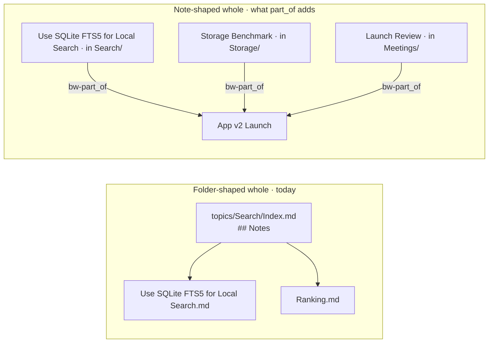

# part_of: belonging to a whole

Status: concluded.
Study: [Typed relations](README.md).
Verdict: revive as `bw-part_of` on each part, covering membership too.

A topic folder is one kind of whole: it holds notes, and its topic page
lists them. This analysis asks what other wholes a brain has, what the
engine would do if it knew about them, and whether that justifies bringing
`part_of` back.

## At a glance

- **Folders give each note one home.** Most other wholes need a note to belong to more than one of them, often in order.
- **A topic page is already a whole.** It lists its notes under `## Notes`; `part_of` extends that to wholes that are notes, declared in frontmatter.
- **One relation, membership included.** A section of a document, a meeting in a series, and a person on a team are all `bw-part_of`; chains are followed one level unless asked.

## 1. Definition

A part_of B: A is a piece or a member of the whole B. A note can be part
of several wholes. Being a member (a person on a team) is part_of too,
rather than a separate relation (§6).

| Not part_of | Example | Where it belongs |
|---|---|---|
| Kind of | "FTS5 **is a** full-text engine" | `type`, tags |
| About | "This note **discusses** SQLite" | A plain link |
| Derived from | "This note **came from** that episode" | `bw-sources` |
| Depends on | "Ranking **needs** the FTS5 index" | `depends_on` |

The format 2 aliases mapped `parent` and `child_of` into part_of, mixing
"kind of" with "part of", the same kind of blur that sank the compass
poles.



## 2. History

| When | What |
|---|---|
| Format 1 (2026-10-10) | `part_of` and `has_part` in a body `## Relations` section |
| Format 2 (`68ab646`, 2026-10-12) | `bw-part_of` and `bw-has_part` fields. A sub-topic's hub was implicitly part_of its parent's hub. Fed the `context` search intent, `neighbors`, BW309 (A part_of B and B part_of A), and the folder tree on the map |
| Format 3 (`4b25b37`, 2026-10-15) | Removed. Membership is the folder; a `bw-part_of` naming the note's own hub was dropped, and any other became a "Part of" bullet under `## Related` |

See [background](background.md) for the full model.

## 3. Use cases

| Whole | Example | Why a folder cannot express it | What it would unlock |
|---|---|---|---|
| Project, task, or PR | A decision in `Search/`, a benchmark in `Storage/`, and a meeting in `Meetings/`, all part of "App v2 Launch" | A note has one folder, and a project cuts across topics (the PARA problem) | Everything about a project across topics, a project rollup, context on any hit |
| Document in parts | A design doc split into section notes; docs-brain splits every long document by `##` | Parts may live in several topics | Reading the whole with its parts; a hit on one section brings the document's summary |
| Series | Weekly 1:1s with Rin, an incident's timeline, release records | Ordered by date, with a summary of the series | The latest in a series and its summary. Consolidation's `record` pattern produces these |
| Procedure | Steps shared by several howtos | Reuse means several parents | Changing a shared step shows every playbook that contains it |
| Membership | A person on a team, a team in an org | The `people/` folder groups by kind, not by team | Who is on a team; the team page lists its members |
| System composition | A component of a service of a system | Architecture rarely matches the folder tree | An architecture outline; with depends_on, impact queries |

Two cases need nothing new: an excerpt of a source is covered by
`bw-sources`, and a topic with a second parent topic can be linked from
that topic's page.

## 4. Behaviors

| Behavior | What it does | Order | Chains |
|---|---|---|---|
| Context | A hit on a part attaches the whole's summary (format 2's `context` intent) | no | one hop |
| Assembly | Reading a whole lists its parts by title, comparing numbers as numbers; reading a part names its wholes | by title | no |
| Scoped search | `brain_search("ranking", within="App v2 Launch")` searches only the whole's parts | no | yes |
| Rollup | A whole shows its parts' counts by status and type and the latest change; orientation could list active projects as it lists topics | no | yes |
| Inheritance | An archived or superseded whole flags its active parts (lint info) | no | yes |
| Lint | Cycles; a part of an archived whole; a `bw-part_of` item that does not resolve | no | yes |
| Map | Wholes as clusters across topics; breadcrumbs from the whole | no | yes |

## 5. Today without it

| Use case | What covers it now | Gap |
|---|---|---|
| Project | A project note that links to its notes; tags | Nothing reads the links as membership; tags have no page, summary, or order |
| Document in parts | Nested listing on the topic page; BW405 treats notes reached from listed notes as listed | Only inside one topic, and order is not read |
| Series | Dated file names in a `Records/` folder | No series page, no "latest" |
| Procedure | Links from each howto | No "contained in" query |
| Membership | Links between person and team notes | No "who is on the team" |
| System composition | Links, folders | Mixed with dependency links |

## 6. Design questions

1. **Which side holds the field?** Settled (2026-10-17): `bw-part_of` on
   each part, the one canonical direction ([syntax](syntax.md)). Joining a
   whole is an edit to the note itself, and a note can name several wholes.
   The field carries no order, and order is not a concept of its own. Where
   it matters, as when the notes of a folder follow a shared template of
   several notes ("1 Overview", "2 Design", "3 Rollout"), the order is part
   of each title, a convention of that folder. Assembly lists parts by
   title, comparing numbers as numbers, so "2 Design" comes before
   "10 Rollout" and dated titles sort by date.
2. **One relation or two?** Settled: part_of covers membership. The
   part-whole literature warns that chains across kinds mislead: a person's
   1:1 notes are part of the person, the person is part of a team, yet the
   notes are not clearly part of the team. That argues against following
   chains automatically, not for a second relation. Scoped search and
   rollups go one level by default and deeper only on request, so a long
   chain adds noise at worst, and part_of carries no guard. One relation
   also follows the [fewer concepts](../README.md#principle-fewer-concepts)
   principle.
3. **Is a note-shaped whole a topic?** A note that other notes name in
   `bw-part_of` behaves like a topic page for notes that live elsewhere.
   Settled (2026-10-18): share the behaviors (context, assembly, rollup, outline reads)
   but not the declaration. A topic's members come from its folder, a
   whole's from the fields that name it, and the folder stays each note's
   only home. Naming one's own topic page in `bw-part_of` repeats the
   folder, and lint reports it.

## 7. Against the criteria

| Criterion | Result | Why |
|---|---|---|
| C1 engine behavior | pass | Context, assembly, scoped search, rollup, and lint are all testable |
| C2 one distinct concept | partial | It sits between folders (one home) and tags (grouping without a page). The line: a whole is a note with its own page, and folder membership is never written as part_of. Membership needs no second relation |
| C3 declared by the author | pass | The author writes the field |
| C4 writable by direct edit | pass | A YAML list of quoted links on the note being written; `brain validate` checks that each item is a link that resolves |
| C5 links only in frontmatter | pass | Each item is one quoted link; no order or qualifier is needed |
| C6 prose stays free | pass | Nothing in the body is read; people may explain membership in `## Relations` or not |
| C7 one direction, safe chains | pass | One field, on each part; chains are followed one level unless asked |
| C8 cost | medium | One field, index edges, a search filter, lint rules, and a share of the new format's converter |

## 8. Verdict

**Revive as `bw-part_of` on each part.** A note names the wholes it
belongs to: a project, a document, a series, a team. It can name several.
The folder stays each note's one home, and folder membership is never
written as part_of.

```markdown
---
title: Use SQLite FTS5 for Local Search
bw-part_of: ["[[App v2 Launch]]"]
---
```

```markdown
---
title: Rin Sato
type: person
bw-part_of: ["[[Search Team]]"]
---
```

A note may also explain, in its own words, why it belongs, in a free
`## Relations` section; brain-wiki does not read it.

- **Smallest scope worth building:** the field; context on search hits;
  assembly in `brain_read` (a whole lists its parts by title, and a part
  names its wholes); search scoped to a whole, one level deep; lint for
  unresolved items, cycles, and a note naming its own topic page.
- **Out of scope for now:** chains deeper than one level, inheritance, map
  clusters.
- **Evidence it works:** the four test cases below, each a synthetic
  version of a kind of grouping found in real brains.

### Test case 1: two meeting series in one folder

```text
topics/Company/Meetings/
  Team Standup.md              the whole
  Team Standup 2026-10-07.md   bw-part_of: ["[[Team Standup]]"]
  Team Standup 2026-10-14.md   bw-part_of: ["[[Team Standup]]"]
  Rin 1-1.md                   the whole
  Rin 1-1 2026-10-09.md        bw-part_of: ["[[Rin 1-1]]"]
```

- Reading `Team Standup` lists its two meetings, 10-07 before 10-14, and
  not the 1:1, though all share a folder.
- A search hit on `Team Standup 2026-10-14` carries the series' summary
  as context.

### Test case 2: people on teams

```text
topics/Teams/Search Team.md  the whole
topics/Teams/Sync Team.md    the whole
topics/People/Rin Sato.md    bw-part_of: ["[[Search Team]]"]
topics/People/Ari Moss.md    bw-part_of: ["[[Search Team]]", "[[Sync Team]]"]
```

- Reading `Search Team` lists Ari Moss, then Rin Sato.
- Ari Moss appears in both teams, and reading Ari Moss names both.

### Test case 3: a project across folders

```text
topics/Company/Projects/App v2 Launch.md             the whole
topics/Search/Use SQLite FTS5 for Local Search.md    bw-part_of: ["[[App v2 Launch]]"]
topics/Storage/Storage Benchmark.md                  bw-part_of: ["[[App v2 Launch]]"]
topics/Storage/Archive Storage Costs.md              no bw-part_of
topics/Company/Meetings/Launch Review 2026-10-14.md  bw-part_of: ["[[App v2 Launch]]"]
```

- A search for "storage" scoped to `App v2 Launch` returns Storage
  Benchmark and not Archive Storage Costs.
- The project's rollup counts three parts, by type and status.
- A search hit on the FTS5 note carries the project's summary as context.

### Test case 4: research filed apart from its subject

```text
topics/Notes App/Sync/Index.md              the Sync topic page, the whole
topics/Notes App/Sync/Conflict Handling.md  in the folder; no bw-part_of
topics/Research/Offline Sync Survey.md      bw-part_of: ["[[Notes App/Sync/Index|Sync]]"]
topics/Notes App/Sync/Merge Rules.md        bw-part_of: ["[[Notes App/Sync/Index|Sync]]"]
```

- Reading the sync topic page lists Offline Sync Survey as a part, beside
  the folder's own notes.
- A search hit on Offline Sync Survey carries the sync topic's summary as
  context.
- Offline Sync Survey stays in the research topic: it does not count toward
  the sync topic's notes.
- Lint reports Merge Rules, which names its own topic page and so repeats
  its folder.

## 9. Open questions

None. Settled on 2026-10-17:

| Question | Answer |
|---|---|
| Which side holds the field? | Each part, in `bw-part_of` |
| A separate member_of? | No. part_of covers membership |
| How are parts ordered? | By title. Order is not a concept; a folder that needs order puts it in its titles |
| What to test first? | Synthetic versions of four groupings found in real brains (§8) |

## Sources

- [Background](background.md) for formats 1 to 3 and the format 2 model.
- `docs/design/02-brain-format.md` §6.4 (implicit containment) and
  `docs/design/04-index-and-retrieval.md` §6.4 (the `context` intent), at
  `4b25b37^`.
- BW405 and nested listing:
  [lint and reports](../../design/lint-and-reports.md).
- Morton E. Winston, Roger Chaffin, and Douglas Herrmann, "A Taxonomy of
  Part-Whole Relations", Cognitive Science 11 (1987): six kinds of
  part-whole relation, and why chains across kinds fail.
