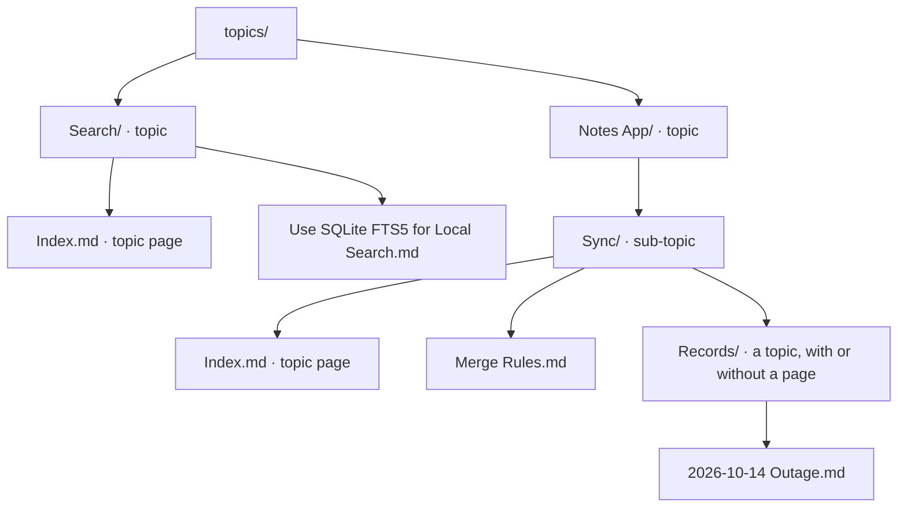

# topic: part_of by folder

Status: concluded. Change 1 built 2026-10-19 ([D40](../../decision/d40-every-folder-is-a-topic.md)); changes 2 and 3 are still to build.
Study: [Typed relations](README.md).
Verdict: keep as the primary part_of; every folder is a topic, and a topic's title lives on its page.

Every note already has one typed relation that nobody writes: its folder
says which topic it is part of. It is the relation brain-wiki uses most and
the one people understand without being told. This analysis treats the
topic as what it is, a part_of expressed by where a file sits, and asks
what brain-wiki should keep, change, or remove about it.

## At a glance

- **The most used relation has no field.** A note's folder says which topic it is part of; every file browser, Obsidian, and git show it.
- **It is part_of with constraints.** One whole per note, wholes nest into a tree, and each whole is a folder with an optional page; `bw-part_of` adds the other wholes a note belongs to.
- **Two rules work against intuition.** Only some deeper folders are topics, and a topic's title can live in two places; both add concepts people must learn.

## 1. Definition

A note is part of the topic whose folder holds it: the nearest enclosing
topic folder. Topics nest, so the topic tree is the folder tree. A topic's
page (`Index.md`), when it has one, describes it and lists its
notes ([D38](../../decision/d38-topic-pages.md)).

| Property | Topic (by folder) | `bw-part_of` (by field) |
|---|---|---|
| Declared by | Where the file sits | A frontmatter field |
| Wholes per note | Exactly one, or none outside `topics/` | Any number |
| Shape | A tree | A graph; cycles are lint errors |
| The whole is | A folder, with an optional topic page | Any note, including a topic page |
| Visible in | Every file browser, Obsidian, git | Obsidian properties, the index |
| Chains | The full ancestry: a sub-topic's notes count toward its parents | One level unless asked |
| Order | By title | By title |

| Not a topic | Example | Where it belongs |
|---|---|---|
| A label | `#draft` on notes in many folders | Tags |
| A kind | "this note is a decision" | `type` |
| A second home | A research note that also belongs to a project | `bw-part_of` |



## 2. History

| When | What |
|---|---|
| Formats 1 and 2, until 2026-10-13 | Topics were flat: each folder directly under `topics/` was a topic, with a hub page. Structure beyond that came from `part_of` relations |
| `e6adaed` (2026-10-13), [D30](../../decision/d30-topic-tree.md) | Topics form a tree: a deeper folder with a hub is a sub-topic. Topics are known by slug, so folders can move. Rejected: flat topics with structure from relations, a `group` field, path-based ids |
| Format 2 | A sub-topic's hub was implicitly `part_of` its parent's hub, stored as an edge with no line in any file |
| `4b25b37` (2026-10-15) | Format 3: folder membership is the only containment; `bw-part_of` is removed |
| `c1e4998` (2026-10-17), [D38](../../decision/d38-topic-pages.md) | Hubs become topic pages; only the page file is one, whatever a note's `type` |

## 3. Use cases

| Use | Example | What the folder gives |
|---|---|---|
| Browsing | Opening `topics/Notes App/Sync/` in Obsidian | The grouping people already see, with no tool |
| Filtering search | `brain_search("conflicts", topic=["notes-app"])` | A topic and all its sub-topics |
| Orientation | The briefing's topic list and the `AGENTS.md` table | What the brain holds, by area, within a budget |
| Writing | "Create `topics/<Topic>/<Note Title>.md`" in the briefing | Where a new note goes, without a field to fill |
| Reorganizing | `brain mv "topics/People/Rin Sato" "topics/Rin Sato"` | Identity by slug, so moving keeps filters and links |
| Context | A topic page summarizing its folder | The page an agent reads first |

## 4. Behaviors

All exist today.

| Behavior | What it does |
|---|---|
| Search filter | `topic=[slug]` matches the topic and its descendants |
| Ranking | Topic pages rank ×1.15 (`kind_factor.topic`) |
| Read | A topic page opens as an outline by default |
| Orientation | Top-level topics, most active first, with counts that include sub-topics |
| `AGENTS.md` | A table of the top-level topics with their pages |
| Lint | BW404 (topic without a page), BW405 (note missing from its page's `## Notes`), BW407 (note outside any topic), BW409 (invalid declared slug) |
| Consolidation | An episode's topic hints bring their topic pages in as candidate notes |
| Map | Groups come from the tree; a topic's folders are its branches |
| Moving | `brain mv` moves a topic folder and rewrites links, as one undoable run |

## 5. Gaps today

| Gap | What happens | Why it matters |
|---|---|---|
| Two kinds of folder | Today, under `topics/`, a top-level folder is always a topic, but a deeper folder is a topic only if it has a page; otherwise it is plain organization and its notes belong to the parent | A file browser shows no difference. A rule people cannot see is a concept they must learn. Settled: every folder is a topic (§6) |
| Two homes for a topic's title | Today, a topic's title and description come from `[topics.<slug>]` in `brain.toml` if declared, else from its page | One fact in two places; a page edit can be silently overridden. Settled: the page only (§6) |
| One home per note | A note cannot belong to a second topic | Covered by `bw-part_of` ([part_of](part-of.md)) |
| Notes outside topics | Allowed (BW407, info), mostly from imported vaults | Fine as is |

## 6. Design questions

1. **Is every folder a topic?** Options:

   | Option | Rule | For | Against |
   |---|---|---|---|
   | A | Every folder under `topics/` is a topic; the page is optional | Matches what people see; one kind of folder | More, smaller topics (`Records/`, `Drafts/`); generic names repeat, so more slugs get their parent's prefix |
   | B | Today: top-level folders always, deeper folders only with a page | Keeps the topic list short | An invisible rule; a page's presence changes what its folder's notes belong to |
   | C | A folder is a topic only with a page, at any depth | One rule | Top-level folders without a page stop being topics; most brains would need pages added |

   Settled (2026-10-17): A. The orientation and `AGENTS.md` already show only top-level
   topics and count the rest, so more sub-topics cost little there, and the
   map already draws every folder. Every folder is a topic, whatever it
   holds. A folder without a topic page is a topic with no content of its
   own: its title is the folder name, and it has no description or
   summary.
2. **Where does a topic's title and description live?** Settled
   (2026-10-17): on its topic page only. Under Title Case naming the page
   is `Index.md`, and it never carries the folder's leading number: the
   folder `00 Inbox Triage/` holds `Index.md` with the title "Inbox
   Triage", and the number stays on the folder, for order. A topic without
   a page, or a page without a title, takes the folder name without its
   leading number (`02 Projects` gives "Projects"), the same rule slugs
   follow. `[topics.<slug>]`
   in `brain.toml` keeps only `path`, for an imported vault whose folder
   names should not become slugs. This removes the second home and follows
   the [fewer concepts](../README.md#principle-fewer-concepts) principle.
3. **How do topics and `bw-part_of` meet?** Settled by the
   [part_of analysis](part-of.md): folder membership is never written as
   `bw-part_of`; naming one's own topic page is a lint report; naming
   another topic's page makes a note part of that topic for context,
   assembly, and scoped search, without changing its folder topic or that
   topic's note count. A topic page may itself name another whole, which
   does not change the tree.

## 7. Against the criteria

| Criterion | Result | Why |
|---|---|---|
| C1 engine behavior | pass | Filtering, ranking, orientation, lint, consolidation, the map, and moving all use it |
| C2 one distinct concept | partial | The relation is the most intuitive grouping there is, but the two-kinds-of-folder rule and the two homes for a title add hidden concepts (§5) |
| C3 declared by the author | pass | The author places the file |
| C4 writable by direct edit | pass | Creating or moving a file; `brain mv` rewrites links |
| C5 links only in frontmatter | pass | Nothing in frontmatter at all |
| C6 prose stays free | pass | The page body is free; only `## Notes` is read, for BW405 |
| C7 one direction, safe chains | pass | Note to folder, one direction; chains follow one kind (folder nesting), so the full ancestry is safe |
| C8 cost | low | It exists; options A and 2 are small changes to the topic tree and the manifest |

## 8. Verdict

**Keep the topic as the primary part_of, and remove two hidden rules.** A
note's folder is its one home and its first whole; `bw-part_of` adds
others.

- **Change 1:** every folder under `topics/` is a topic, whether or not it
  has a topic page. Without one, the topic has no content of its own.
- **Change 2:** a topic's title and description come only from its
  topic page (`Index.md` under Title Case naming, never numbered),
  defaulting to the folder name without a leading number; `brain.toml`
  keeps only `path`.
- **Change 3:** where topics are listed by name, they follow their folder
  names, not their slugs, so a leading number orders them as Obsidian
  does.
- **Out of scope:** multiple homes for a note (that is `bw-part_of`), and
  topics outside `topics/`.
- **Evidence it works:** the test cases below.

### Test case 1: a plain folder becomes a sub-topic

```text
topics/Notes App/Sync/Index.md                      the Sync topic page
topics/Notes App/Sync/Merge Rules.md
topics/Notes App/Sync/Records/2026-10-14 Outage.md  no page in Records/
topics/Notes App/Sync/Images/Merge Flow.png         no notes in Images/
```

- `Records/` is a sub-topic of Sync, and the outage note belongs to it; a
  search filtered to the topic `notes-app` still finds the note.
- `Images/` is a topic too, with no notes and no content of its own.
- The briefing lists Notes App with its sub-topic count, not Records or Images
  on their own lines.

### Test case 2: generic folder names repeat

```text
topics/Notes App/Sync/Records/
topics/Company/Records/
```

- Both are topics; the slugs are `records` for the shallower folder and
  `sync-records` for the deeper one, by the existing rule.

### Test case 3: one home for a title

```text
topics/Notes App/Index.md  title: Notes App, description: The mobile notes app
brain.toml                 [topics.notes-app] title = "Notes"
```

- The topic's title is "Notes App", from the page; the
  `title` key in `brain.toml` is an unknown key (BW109) that `lint --fix`
  moves to the page if the page has none.

### Test case 4: numbered folders

```text
topics/00 Inbox Triage/Index.md  title: Inbox Triage
topics/00 Inbox Triage/Weekly Sweep.md
topics/01 Budget/Index.md        no title in the page
```

- The topics' slugs are `inbox-triage` and `budget`. Their titles are
  "Inbox Triage", from its page, and "Budget", from its folder name without
  the number. The leading numbers only order them.
- Where topics are listed by name, as in `brain topics`, Inbox Triage comes
  before Budget, as in Obsidian, although its slug sorts after.

## 9. Open questions

None. Settled on 2026-10-17:

| Question | Answer |
|---|---|
| Which folders are topics? | Every folder under `topics/`, whether or not it has a topic page (option A); without one, the topic has no content of its own |
| Where do a topic's title and description live? | On its topic page only (`Index.md` under Title Case naming, never numbered), defaulting to the folder name without a leading number; `brain.toml` keeps only `path` |

## Sources

- [brain format §2.1](../../design/brain-format.md#21-topics) and
  [§8](../../design/brain-format.md#8-topic-pages).
- [D30](../../decision/d30-topic-tree.md) and
  [D38](../../decision/d38-topic-pages.md); commits `e6adaed`, `4b25b37`,
  `c1e4998`.
- [Background](background.md) for the format 2 implicit containment.
- [part_of](part-of.md) for how topics and `bw-part_of` meet.
